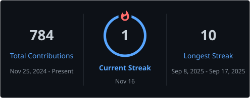

# 👋 Hey, I'm Maksym aka **L1smer**

**Full-Stack Developer · Startup Builder · ML/AI Learner**

**Jump to:** [🧭 At a glance](#-at-a-glance) · [📊 Stats](#-github-stats) · [🚀 Projects](#-projects) · [🔨 Now](#-what-im-working-on-now)

---

## 🧭 At a glance

| | |
|---|---|
| 💼 **Day job** | Full-stack engineer. React Native on mobile, NestJS and PostgreSQL on the backend, deployed on Azure. Frontend roots in React, TypeScript, and Next.js. |
| 🚀 **Startup** | [Watcher](https://www.aimpiria.com/watcher): an app that turns your personality and preferences into personalized movie recommendations. I work on the product across the whole stack and also run its marketing. |
| 🧠 **Learning & passion** | Python and ML/AI, with a focus on hybrid on-device AI. Mobile development. Cloud infrastructure and deployment |
| 🎓 **University** | BSc in Teleinformatics (ICT) at Wrocław University of Science and Technology. |
| ❤️ **Cares about** | End-to-end development, clean and typed code, automation, and systematicity.  |

---

## 📊 GitHub Stats

  
  

  

Generated once a day by <a href="./.github/workflows/readme-cards.yml">a GitHub Action</a> and committed to this repo.

---

## 🚀 Projects

| Project | What it is |
|---|---|
| **[Watcher](https://www.aimpiria.com/watcher)** | Mobile app with AI-driven, personalized movie recommendations based on who you are and what you like. Expo app with a NestJS, PostgreSQL, and Azure backend. Source is private. |
| **[uber-simulation](https://github.com/L1smer/uber-simulation)** | Ride-sharing simulation built as a university team project that I led. Java 21 and Spring Boot backend, React and TypeScript frontend. Dijkstra pathfinding on a road graph, Haversine distances, live updates over WebSockets, a canvas-rendered map, and a Strategy pattern for driver matching. |
| **[job-scraper](https://github.com/L1smer/job-scraper)** | Job-alert bot that checks JustJoin.it, NoFluffJobs, LinkedIn, and Indeed every hour with GitHub Actions and sends new matching vacancies to Telegram. |

---

## 🔨 What I'm working on now

| Project | What it is |
|---|---|
| **[Watcher](https://www.aimpiria.com/watcher)** | Finishing the remaining premium features, growing the user base, and building the app's social media presence. |
| **Receipt AI** | Mobile app that turns a photo of a receipt into structured spending data. An LLM parses the receipt text, since every shop prints receipts differently, and the app keeps monthly statistics for a personal finance report. |

---

**Open to full-stack and frontend roles.** The fastest way to reach me are <maksimkrasnov747@gmail.com> or [LinkedIn](https://www.linkedin.com/in/maksym-krasnov-113b40357).

